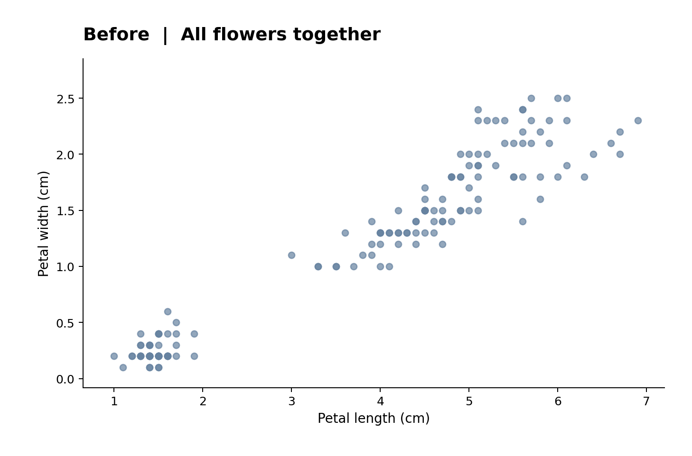
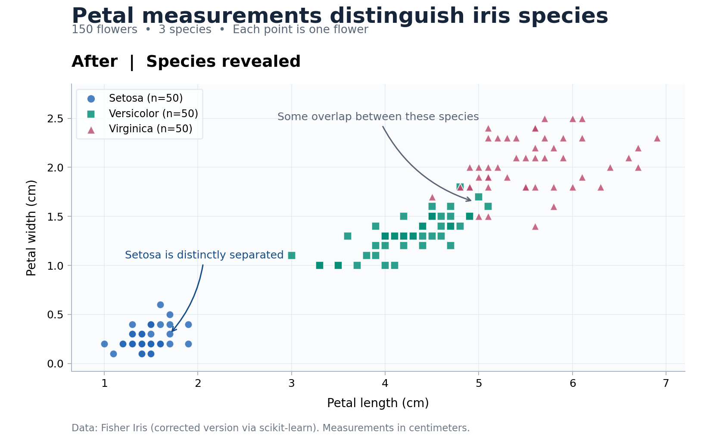
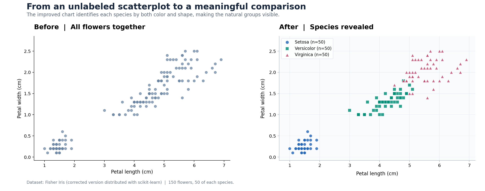

# Iris Species: Before-and-After Scientific Data Visualization

## Project overview

This project explores whether petal measurements help distinguish **three iris flower species**. It uses 150 flowers (50 each of *Setosa*, *Versicolor*, and *Virginica*) from the classic Fisher Iris dataset, a widely used introductory benchmark for statistical classification and machine learning.

### Before



The initial scatterplot correctly shows petal length and petal width, but treats all flowers identically. It makes it difficult to determine which flower belongs to which species.

### After



The improved figure:

- Uses distinct **colors and marker shapes** to identify the three species.
- Adds a **legend with sample sizes** and explanatory annotations.
- Keeps consistent **units, scales, and labeled axes**.
- Uses subtle gridlines and clear typography to make the pattern easy to see.

**Observation:** Setosa flowers occupy a distinct group in petal-length and petal-width space. Versicolor and Virginica flowers overlap somewhat, so these two features alone do not perfectly separate them. This is an exploratory visualization, not a trained classification model.

### Combined comparison for course submission



## Files

- `data/iris_fisher.csv` — 150 rows of flower measurements and species labels.
- `src/visualize_iris.py` — reproducible Python code that generates the three images.
- `before.png` — simple initial figure.
- `after.png` — improved figure.
- `before_after_comparison.png` — both figures in one image, suitable for uploading to a course assignment.
- `requirements.txt` — Python package requirements.

## How to reproduce

With Python 3 installed, open a terminal in this folder and run:

```bash
python -m pip install -r requirements.txt
python src/visualize_iris.py
```

The generated figures will be written to the `figures` directory. No internet connection or API key is required.

## Dataset source / credit

This project uses the **corrected Fisher Iris dataset distributed with scikit-learn**, rather than claiming to have collected new observations. It is closely related to the [UCI Machine Learning Repository Iris dataset](https://archive.ics.uci.edu/dataset/53/iris), which notes a two-row discrepancy from Fisher's original data. The version packaged with scikit-learn corrects the two observations to match Fisher's original paper.

- [scikit-learn `load_iris` documentation](https://scikit-learn.org/stable/modules/generated/sklearn.datasets.load_iris.html)
- [UCI Iris Dataset (Fisher, 1936), DOI: 10.24432/C56C76](https://archive.ics.uci.edu/dataset/53/iris)

Source acknowledgement: R. A. Fisher (1936), *The use of multiple measurements in taxonomic problems*; dataset adapted via scikit-learn. The UCI repository lists CC BY 4.0 for its published Iris dataset, but the included CSV follows scikit-learn's corrected version.
